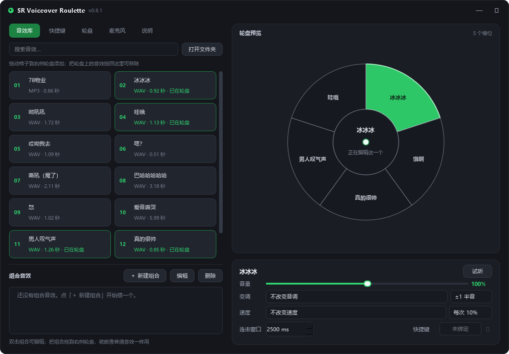
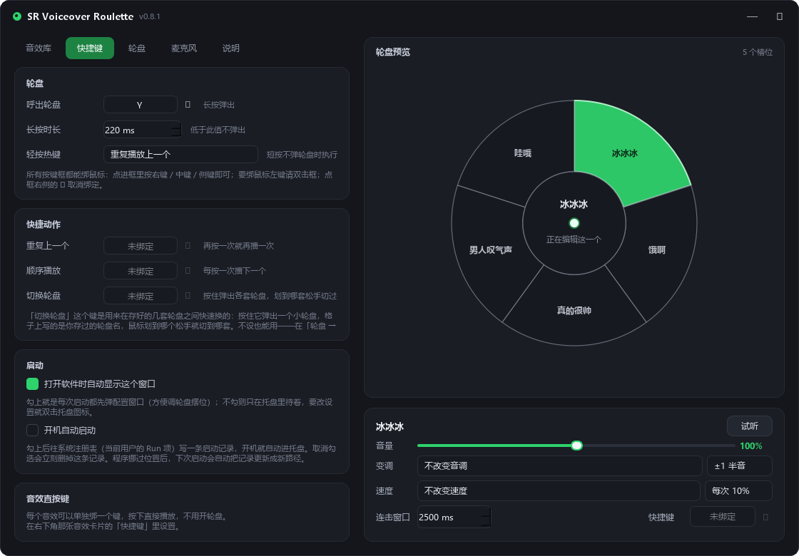
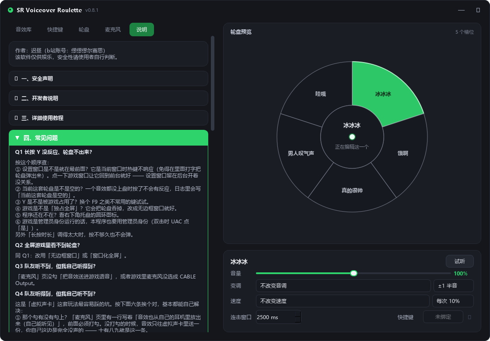

# SR Voiceover Roulette

一个**游戏内音效轮盘**，任何游戏都能用。长按一个键，屏幕中间弹出轮盘，鼠标一划、松手，你放进去的语音就播出来了。

纯 Python + PySide6 写的 Windows 小工具。**不联网、不注入、不读内存、不模拟按键**——只做三件事：读你的按键、播你放进去的音频、把声音送到声卡。



## 它有什么

- **长按弹轮盘 / 单击重播**：长按热键约 0.25 秒弹出，松开即播；轻点一下则重播上一个，不用开轮盘
- **热键能绑组合键**：`Ctrl+Shift+Y` 这种也行，左右 Ctrl 不分，老的单键设置照样能用
- **暂停模式**：在轮盘中心松手 = 停掉声音 + 暂停（快捷键暂时失效），再松手一次或直接选个音效就恢复
- **多套轮盘**：最多 8 套，各自独立摆位、独立颜色，一个热键循环切换
- **轮盘能调大小**：直径、中空比例、整体大小（70%~140%，内外圈和文字一起缩放）随便调；中空留白多大，中心"不选中"的范围就多大，所见即所选
- **每个音效单独调**：音量、变调（固定半音或随机范围）、速度、连击窗口、专属快捷键
- **组合音效**：把几个音效串起来——延迟、升调、随机抽卡、A 播完接 B，都能排；音效多了可以搜
- **送进游戏语音**：配 VB-CABLE 这类虚拟声卡，把你说话的原声和音效一起送进游戏麦克风
- **能看见的配色**：应用主题色（界面）和轮盘颜色（轮盘本体）互相独立，都能自己取色
- **有动画，也能关**：轮盘弹出与释放都有过渡，嫌挡视线就在「轮盘 → 外观」里一键关掉
- **带说明书**：程序里就有完整教程和常见问题，不用来回翻文档





## 跑起来

要求 Windows 10/11 + Python 3.10 以上（开发环境是 3.13）。

```bash
pip install -r requirements.txt
python sr_roulette.py
```

启动后会缩到右下角托盘，长按 `Y` 弹轮盘。配置窗口里最后一个标签页「说明」写了完整用法。

音效文件丢进 `sounds/` 目录，回到程序点「重新扫描」，就能拖到轮盘上用了。wav / mp3 / ogg / flac / m4a 都认。

## 打包成 exe

```bash
pip install pyinstaller
python -m PyInstaller SVRoulette.spec --noconfirm --clean
```

输出在 `dist/SR Voiceover Roulette.exe`。spec 里开了 `uac_admin=True`，打出来的 exe 会带管理员权限清单——游戏和语音软件常以管理员身份运行，权限低一档时读按键、占设备都可能被 Windows 挡下来。

## 目录

```
sr_roulette.py        主程序：热键轮询、轮盘窗口、音频引擎、托盘
settings_window.py    设置窗口（音效库 / 快捷键 / 轮盘 / 麦克风 / 说明）
sounds_config.py      sounds.json 的读写、多套轮盘、组合音效的模型
theme.py              配色的唯一来源（主题色、轮盘色、深浅推导）
SVRoulette.spec       PyInstaller 打包配置
使用说明.txt          随 exe 一起发给最终用户的说明书
sounds/               音效就放这儿
_tests/               各功能的自测脚本，每个都能单独跑
docs/                 README 用的截图
```

`_tests/` 下每个脚本都是独立的，直接 `python _tests/_t_xxx.py` 就能跑，不需要 pytest。当初写它们是为了每改一处都能立刻验证，现在一起放出来——你可以自己跑一遍，看它是不是真如上面所说。

## 关于仓库里那几个音效

`sounds/` 里带了 13 个音频，纯粹是为了让下载下来的人能立刻听到声音、看看效果。**它们都是网络上流传的梗音频，版权归各自原作者**，本项目不主张任何权利，也不对它们收费，仅作功能演示之用。如果权利人认为不妥，提个 issue 或直接联系我，我会立刻删掉。

自己用的时候，把它们换成你自己的文件就好。

## 说清楚风险

- 本程序是个人写的第三方工具，与任何游戏及其开发商、发行商**没有任何关系**，也不是任何游戏的官方工具。
- 在竞技对局里放语音可能被队友嫌弃、可能违反游戏规则、**可能被封号**。这件事只能你自己判断，作者不承担后果。
- 程序会申请**管理员权限**、写一个开机自启注册表项（默认关闭，你开了才写）、在程序目录读写 `config.json` / `sounds.json` / `sr_roulette.log`。除此之外不碰系统目录，不装驱动，不装证书。
- 完整的安全声明在 `使用说明.txt` 和程序内「说明 → 一、安全声明」里，写得比这里细。

## 许可

[MIT](LICENSE) © 2026 ChiZhou（迟昼）

作者：迟昼（B 站：缪缪缪尔赛思）
